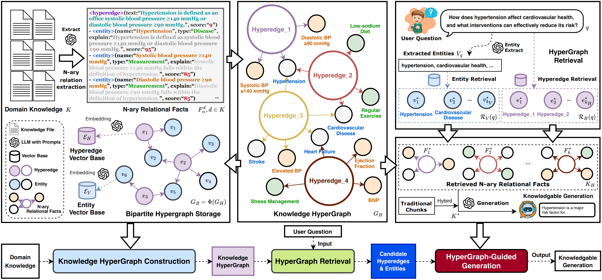

# HyperGraphRAG

Official resources of **"HyperGraphRAG: Retrieval-Augmented Generation via Hypergraph-Structured Knowledge Representation"**. Haoran Luo, Haihong E, Guanting Chen, Yandan Zheng, Xiaobao Wu, Yikai Guo, Qika Lin, Yu Feng, Zemin Kuang, Meina Song, Yifan Zhu, Luu Anh Tuan. **NeurIPS 2025** \[[paper](https://proceedings.neurips.cc/paper_files/paper/2025/hash/df55ee6e59f8ac4a625219e11fe9ddba-Abstract-Conference.html)\].

##  Overview 



## Environment Setup
```bash
conda create -n hypergraphrag python=3.11
conda activate hypergraphrag
pip install -r requirements.txt
```

## Quick Start
### Knowledge HyperGraph Construction
```python
import os
import json
from hypergraphrag import HyperGraphRAG
os.environ["OPENAI_API_KEY"] = "your_openai_api_key"

rag = HyperGraphRAG(working_dir=f"expr/example")

with open(f"example_contexts.json", mode="r") as f:
    unique_contexts = json.load(f)
    
rag.insert(unique_contexts)
```

### Knowledge HyperGraph Query
```python
import os
from hypergraphrag import HyperGraphRAG
os.environ["OPENAI_API_KEY"] = "your_openai_api_key"

rag = HyperGraphRAG(working_dir=f"expr/example")

query_text = 'How strong is the evidence supporting a systolic BP target of 120–129 mmHg in elderly or frail patients, considering potential risks like orthostatic hypotension, the balance between cardiovascular benefits and adverse effects, and the feasibility of implementation in diverse healthcare settings?'

result = rag.query(query_text)
print(result)
```

> For evaluation, please refer to the [evaluation](./evaluation/README.md) folder.

## BibTex

If you find this work is helpful for your research, please cite:

```bibtex
@inproceedings{luo2025hypergraphrag,
 author = {Luo, Haoran and E, Haihong and Chen, Guanting and Zheng, Yandan and Wu, Xiaobao and Guo, Yikai and Lin, Qika and Feng, Yu and Kuang, Zemin and Song, Meina and Zhu, Yifan and Luu, Anh Tuan},
 booktitle = {Advances in Neural Information Processing Systems},
 doi = {10.52202/085713-5089},
 editor = {D. Belgrave and C. Zhang and H. Lin and R. Pascanu and P. Koniusz and M. Ghassemi and N. Chen},
 pages = {152206--152234},
 publisher = {Curran Associates, Inc.},
 title = {HyperGraphRAG: Retrieval-Augmented Generation via Hypergraph-Structured Knowledge Representation},
 url = {https://proceedings.neurips.cc/paper_files/paper/2025/file/df55ee6e59f8ac4a625219e11fe9ddba-Paper-Conference.pdf},
 volume = {38, Main Conference},
 year = {2025}
}
```

For further questions, please contact: haoran.luo@ieee.org.

## Acknowledgement

This repo benefits from [LightRAG](https://github.com/HKUDS/LightRAG), [Text2NKG](https://github.com/LHRLAB/Text2NKG), and [HAHE](https://github.com/LHRLAB/HAHE).  Thanks for their wonderful works.
